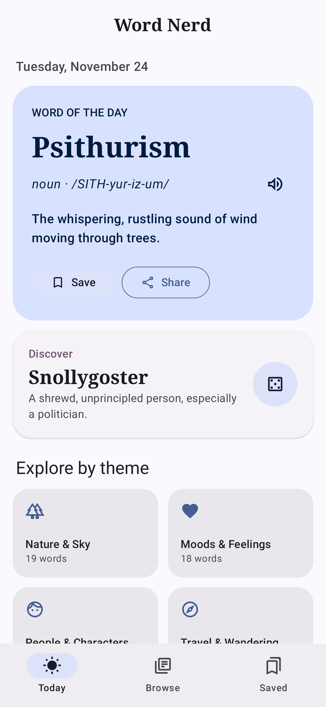
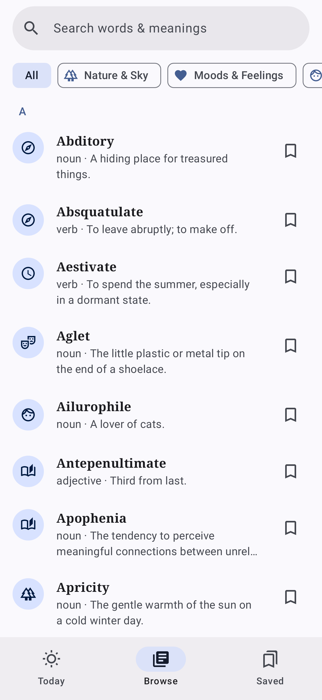
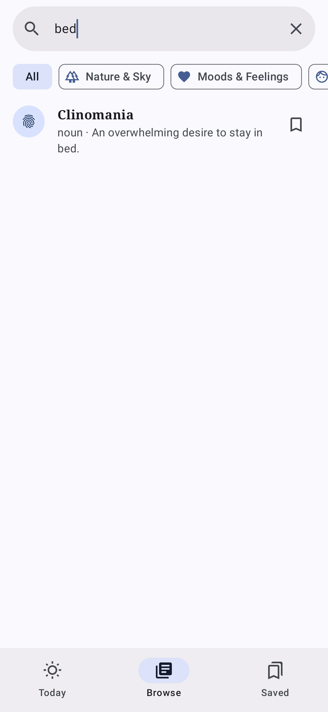
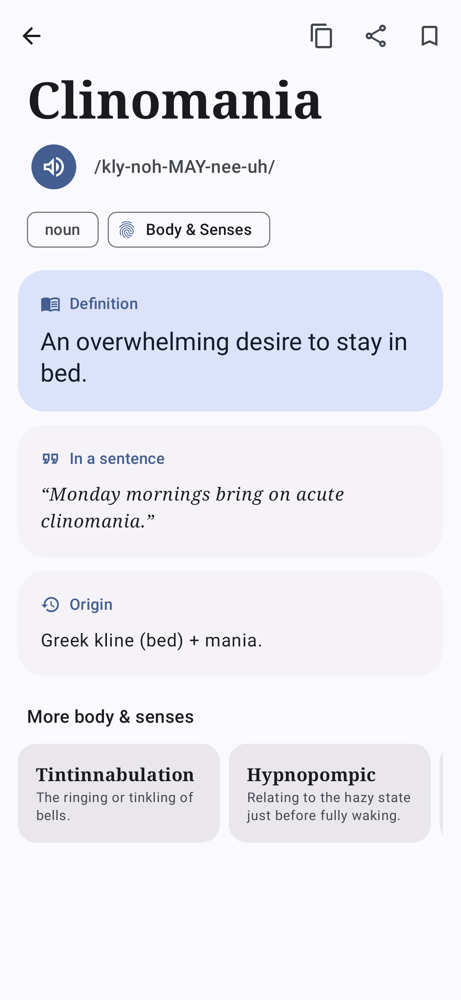
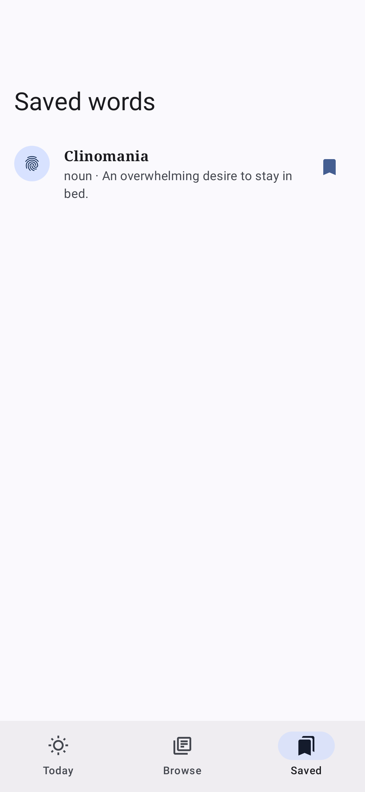

# Word Nerd — a dictionary of obscure & enchanting words

An Android app for collecting delightful, rarely used words: *petrichor*, *apricity*,
*mundivagant*, *pogonophile*, *tarantism* and about 135 more. Built with Kotlin, Jetpack
Compose and Material 3 (Material You), in the style of Google's own apps.

| Today | Browse | Search | Word | Saved |
|---|---|---|---|---|
|  |  |  |  |  |

## Features
- **Word of the day**: a new word every day, with Save and Share buttons.
- **Discover**: shuffle through random words.
- **Browse**: the whole lexicon A–Z with sticky letter headers, a pill search bar that
  searches headwords and meanings, and filter chips for 9 themes.
- **Word pages**: pronunciation (tap the speaker to hear it read aloud), part of speech,
  definition, an example sentence, origin/etymology, and related words.
- **Saved**: bookmark favourites; they are kept on the device with DataStore.
- Copy and share any word.
- Material You dynamic color on Android 12+ (with a teal fallback palette), dark theme,
  edge-to-edge, splash screen, and a themed adaptive icon.

All definitions, etymologies and example sentences are written fresh for this app.

## Install
Sideload `WordNerd.apk` (a release build signed with a debug key) on Android 8.0 or later.

## Build
Requires JDK 17+ and the Android SDK (platform 35).
```
./gradlew assembleDebug        # app/build/outputs/apk/debug/app-debug.apk
./gradlew testDebugUnitTest    # Robolectric screenshots → app/build/screenshots
```

## Adding words
Edit `app/src/main/java/com/wordnerd/dictionary/data/Words.kt`; each entry is one
`w(word, pronunciation, partOfSpeech, definition, origin, example, category)` call.
